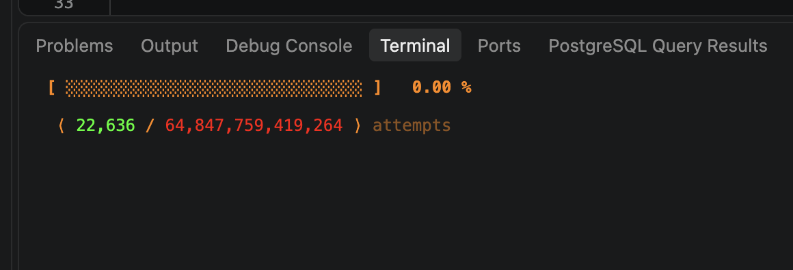
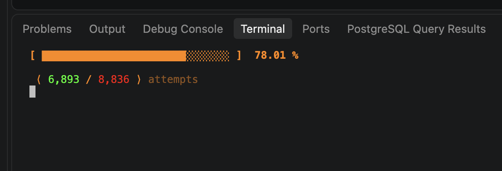
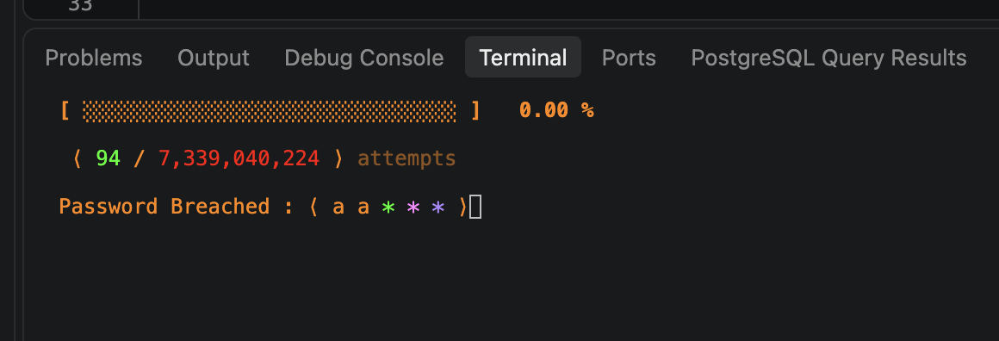
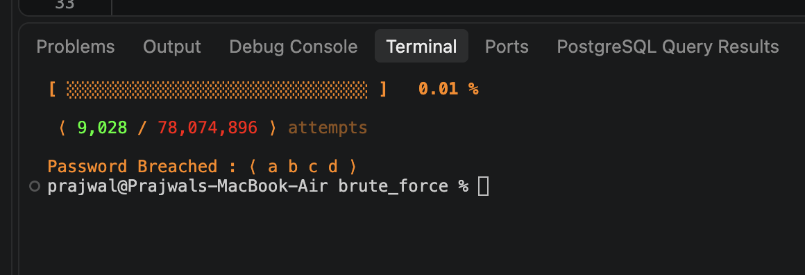

# BruteBeetle 🪲

### Every combination. Every possibility.

A recursive brute-force password search engine that systematically generates and tests character combinations until a match is found.

Part of **[pass-lab](https://github.com/prajwaljshetty/pass-lab)** — exploring exhaustive search, recursive generation, hash verification, and the computational complexity of password searching.

 

## How It Works

BruteBeetle recursively constructs candidate passwords character by character and verifies each complete candidate against a stored SHA-256 hash. A custom exception halts the search the moment a match is found.

1. Initialize the character set and target length
2. Recursively generate candidate combinations
3. Verify each candidate against the stored hash
4. Track attempts and display search progress
5. Stop the search when a match is found
6. Reveal the recovered password through a terminal animation

 

## Demonstration

**Search progress**
Monitor attempted combinations and the percentage of the search space explored.

  

  

**Password discovery**
Watch BruteBeetle progressively reveal the recovered password once a match is found.

  

  

